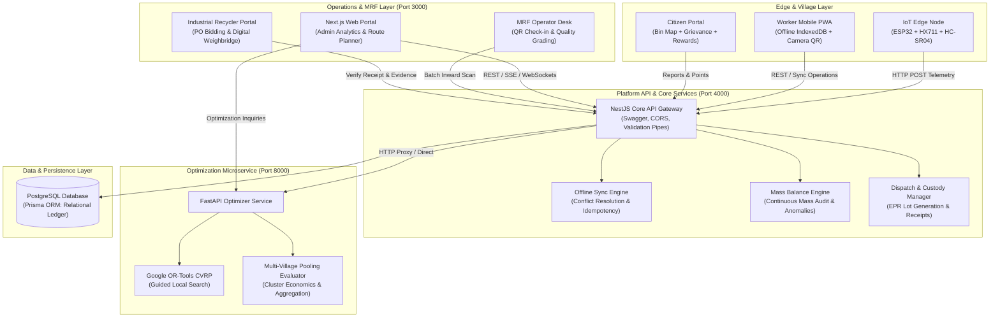
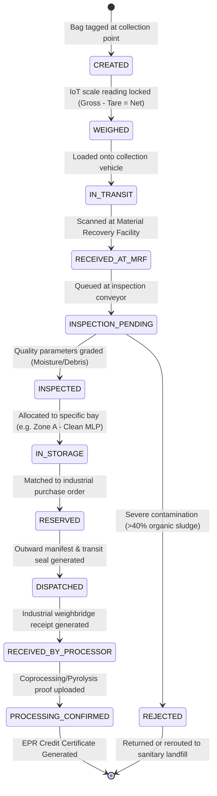

# GRAM-CIRCULAR: System Architecture & Technical Specification

**Rural Multi-Layered Plastic (MLP) & Solid Waste Aggregation, Traceability, and Route Optimization Platform**  
*Smart India Hackathon (SIH 2026)*

---

## 1. System Overview & Vision

GRAM-CIRCULAR addresses the critical breakdown in rural solid waste management across India: the informal leakage, open burning, and uncollected dumping of Multi-Layered Plastics (MLP) and dry recyclables. 

Gram Panchayats currently lack:
1. **Verifiable origin weighing** at decentralized village collection points.
2. **Aggregated economies of scale**: formal industrial coprocessors and cement plants require minimum lot sizes ($\ge 500\text{–}1000\text{ kg}$) that single villages cannot fulfill alone.
3. **Optimized fleet logistics**: high diesel expenditures on uncoordinated collection runs.
4. **End-to-End Mass Balance Ledger**: transparent audit trails required by Central Pollution Control Board (CPCB) Extended Producer Responsibility (EPR) mandates.

GRAM-CIRCULAR bridges this gap with an integrated edge-to-cloud architecture:

```
[IoT Smart Scale & Bin Nodes] 
             │ (WiFi / HTTP REST)
             ▼
[Worker Offline-First PWA / Mobile] 
             │ (IndexedDB Sync / Background Sync)
             ▼
[NestJS Core API Gateway & Business Engine] ─── PostgreSQL (Prisma ORM)
             │ 
             ├─── [Google OR-Tools Python Optimizer Service] (CVRP & Waste Pooling)
             └─── [Next.js Admin & Operator Command Center] (Real-time Dashboards)
```

---

## 2. High-Level Component Diagram



---

## 3. End-to-End Data & Material Flow

```mermaid
sequenceDiagram
    autonumber
    actor Worker as Village Collector
    participant IoT as ESP32 Smart Scale
    participant App as Mobile PWA
    participant API as NestJS API
    participant DB as PostgreSQL
    actor MRF as MRF Operator
    participant Opt as OR-Tools Optimizer
    actor Buyer as Recycler / Cement Plant

    Note over Worker, IoT: Step 1: Village Collection & Weighing
    Worker->>IoT: Place collected MLP bag on scale platform
    IoT->>IoT: 10-sample moving filter (tolerance < 50g)
    IoT-->>App: Stable weight broadcasted (or entered via UI)
    Worker->>App: Confirm gross/tare weight, tag QR code
    App->>API: POST /api/v1/batches (Client Op ID for idempotency)
    API->>DB: Insert WasteBatch (Status: WEIGHED)

    Note over Worker, MRF: Step 2: Route Optimization & Haulage
    API->>Opt: POST /api/v1/optimize/route (CVRP stop demands)
    Opt-->>API: Optimized vehicle sequence & 24% diesel savings
    API->>DB: Create RoutePlan & RouteStops

    Note over MRF, DB: Step 3: MRF Inward Scan & Quality Inspection
    MRF->>App: Scan Bag QR Token
    App->>API: GET /api/v1/batches/qr/:token
    MRF->>API: POST /api/v1/batches/:id/inspection (Contamination, Grade A/B/C)
    API->>DB: Update BatchStatus -> INSPECTED, assign StorageZone

    Note over MRF, Opt: Step 4: Multi-Village Pooling & Dispatch
    API->>Opt: POST /api/v1/optimize/pooling (Assess multi-panchayat cluster)
    Opt-->>API: Optimal batch threshold met (620 kg > 500 kg min)
    MRF->>API: POST /api/v1/dispatches (Assign vehicle & destination)
    API->>DB: Create Dispatch & reserve batches (Status: DISPATCHED)

    Note over Buyer, DB: Step 5: Processor Handover & Mass Balance
    Buyer->>API: POST /api/v1/dispatches/:id/receipt (Weighbridge receipt)
    API->>DB: Reconcile received weight vs dispatch weight
    Buyer->>API: POST /api/v1/dispatches/:id/evidence (Co-processing video/manifest)
    API->>DB: Set BatchStatus -> PROCESSING_CONFIRMED
    API->>DB: Recalculate Mass Balance Ledger & Flag anomalies
```

---

## 4. State Machine for Multi-Layered Plastic (MLP) Batches

The lifecycle of every kilogram of MLP is tracked deterministically via an immutable finite state machine:



---

## 5. Continuous Mass Balance Calculation & Anomaly Engine

To eliminate ghost invoicing and meet CPCB EPR auditing guidelines, GRAM-CIRCULAR enforces a strict physical mass conservation law:

### Mass Conservation Equation
For any given accounting time window $T$ across the Panchayat cluster and MRF:

$$\sum W_{\text{collected}} = \Delta W_{\text{storage}} + \sum W_{\text{dispatched}} + \sum W_{\text{moisture/process loss}} + \epsilon_{\text{discrepancy}}$$

Where:
- $\sum W_{\text{collected}}$: Sum of net batch weights collected from all village collection points.
- $\Delta W_{\text{storage}}$: Change in physical inventory stored across MRF storage bays $(S_{\text{current}} - S_{\text{initial}})$.
- $\sum W_{\text{dispatched}}$: Certified weight transferred to authorized recyclers.
- $\sum W_{\text{loss}}$: Recorded tare, sorting rejects, and moisture loss during drying.
- $\epsilon_{\text{discrepancy}}$: Residual discrepancy.

### Anomaly Flagging Rules
The automated audit worker executes every 15 minutes or upon each dispatch event:

1. **Weight Discrepancy Threshold**:
   $$\text{Variance \%} = \frac{|W_{\text{dispatch}} - W_{\text{received}}|}{W_{\text{dispatch}}} \times 100$$
   - If $\text{Variance} > 3.0\% \implies$ Warning notification logged.
   - If $\text{Variance} > 7.5\% \implies$ `STOCK_DISCREPANCY` Anomaly flagged; dispatch blocked from EPR certificate issuance until supervisor resolution.
2. **Duplicate Batch Scan**: If an identical `qrToken` or client operation is processed twice within 24 hours $\implies$ `DUPLICATE_BATCH` critical anomaly.
3. **Dispatch Exceeding Stock**: If an outward dispatch is scheduled with weight greater than current bay inventory $\implies$ `DISPATCH_EXCEEDS_STOCK`.

---

## 6. Security, Offline Reliability & SIH Demo Architecture

### Frictionless Role Switching for Hackathon Evaluation
In traditional enterprise apps, testing multiple user journeys requires logging out, switching credentials, or clearing cookies. For the SIH 2026 jury evaluation:
- The top navigation bar houses a **Demo Role Selector**:
  - `ADMIN`: Macro Analytics, Cluster Maps, Fleet Route Planner.
  - `WORKER`: Fast Mobile Weighing, Bag Creation, Offline Sync Drawer.
  - `MRF_OPERATOR`: Camera QR Scanner, Contamination Grading, Storage Bay Allocation.
  - `BUYER`: Industrial Recycler Purchase Orders, Weighbridge Receipt Upload.
  - `CITIZEN`: Bin Fill Map, Litter Reporting, Green Reward Points.
- Role switching happens instantly on the client side without token disruption.

### Offline-First Architecture (Rural Connectivity Resiliency)
Villages often experience intermittent cellular connectivity (Edge / 2G or zero coverage).
- **Client-Side Storage**: The Worker PWA uses **Dexie.js (IndexedDB)** to store created batches, offline collection logs, and photo blobs locally.
- **Idempotent Sync Queue**: Every batch has a UUID `clientOperationId`. When network is restored, queued operations are synced sequentially to `POST /api/v1/sync/batch`. If a network interruption causes a resubmission, the backend detects the duplicate UUID and prevents double-crediting.
