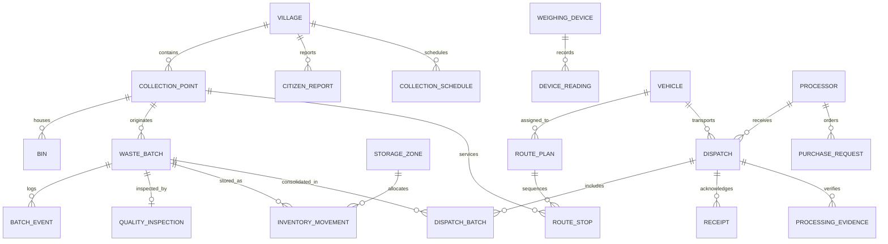

# GRAM-CIRCULAR: Relational Database Schema & Data Dictionary

**Engine**: PostgreSQL 16+  
**ORM**: Prisma ORM  
**Architecture**: Relational Mass-Balance Ledger with Immutable Event Sourcing

---

## 1. Entity-Relationship (ER) Diagram

---

## 2. Enumerations Specification

| Enum Name | Allowed Values | Usage Description |
| :--- | :--- | :--- |
| **`UserRole`** | `ADMIN`, `WORKER`, `MRF_OPERATOR`, `BUYER`, `CITIZEN` | Role-based UI view switching & operational permissions |
| **`WasteStream`** | `WET`, `DRY`, `SANITARY`, `SPECIAL_CARE` | High-level municipal waste segregation categories |
| **`MaterialSubtype`** | `MLP`, `PAPER`, `GLASS`, `METAL`, `RIGID_PLASTIC`, `TEXTILE`, `ORGANIC`, `OTHER` | Granular recyclable categorization (MLP = Multi-Layered Plastic) |
| **`BatchStatus`** | `CREATED`, `WEIGHED`, `IN_TRANSIT`, `RECEIVED_AT_MRF`, `INSPECTION_PENDING`, `INSPECTED`, `IN_STORAGE`, `RESERVED`, `DISPATCHED`, `RECEIVED_BY_PROCESSOR`, `PROCESSING_CONFIRMED`, `REJECTED` | Strict sequential finite state machine for physical waste bags |
| **`InspectionOutcome`**| `PASSED`, `CONDITIONAL`, `REJECTED` | MRF conveyor intake evaluation result |
| **`QualityGrade`** | `A`, `B`, `C`, `REJECTED` | Quality classification based on moisture, grit & separation purity |
| **`DispatchStatus`** | `DRAFT`, `CONFIRMED`, `IN_TRANSIT`, `DELIVERED`, `DISPUTED` | Consignment delivery tracking between MRF and Industrial Buyer |
| **`BinFillLevel`** | `EMPTY`, `LOW`, `MEDIUM`, `HIGH`, `FULL`, `OVERFLOW` | Bin volume status derived from ultrasonic depth sensor |
| **`WeightSource`** | `SENSOR`, `SIMULATED`, `MANUAL` | Hardware telemetry origin tag for regulatory audit transparency |
| **`RouteStatus`** | `PLANNED`, `IN_PROGRESS`, `COMPLETED`, `CANCELLED` | Vehicle collection dispatch lifecycle |
| **`SyncState`** | `PENDING`, `SYNCING`, `SYNCED`, `CONFLICT`, `ERROR` | Offline-first synchronization pipeline tracking |
| **`AnomalyType`** | `DUPLICATE_BATCH`, `UNUSUAL_WEIGHT`, `DISPATCH_EXCEEDS_STOCK`, `MISSING_RECEIPT`, `STOCK_DISCREPANCY`, `PROCESSING_EXCEEDS_RECEIVED` | Mass balance audit flags raised by automated verification worker |

---

## 3. Data Dictionary: Core Tables

### 3.1 `villages`
Geographic master of participating Gram Panchayats.

| Column | Type | Constraints | Description |
| :--- | :--- | :--- | :--- |
| `id` | UUID | PK, default `uuid()` | Unique village identifier |
| `name` | VARCHAR | NOT NULL | Gram Panchayat / Village name |
| `district` | VARCHAR | NOT NULL | District (e.g., Coimbatore) |
| `taluk` | VARCHAR | NOT NULL | Sub-district / Taluk |
| `pincode` | VARCHAR(6) | NOT NULL | Indian Postal Code |
| `latitude` | DECIMAL(9,6) | NOT NULL | GPS centroid latitude |
| `longitude` | DECIMAL(9,6) | NOT NULL | GPS centroid longitude |
| `population` | INTEGER | NOT NULL | Census / voter population |
| `wardCount` | INTEGER | NOT NULL | Number of administrative wards |
| `isActive` | BOOLEAN | DEFAULT true | Cluster active status |

---

### 3.2 `collection_points`
Physical designated waste drop-off and pickup locations within villages.

| Column | Type | Constraints | Description |
| :--- | :--- | :--- | :--- |
| `id` | UUID | PK, default `uuid()` | Collection point ID |
| `villageId` | UUID | FK -> `villages.id` | Associated Gram Panchayat |
| `name` | VARCHAR | NOT NULL | Name (e.g., "CP-01 Main Market Junction") |
| `address` | TEXT | NOT NULL | Street landmark address |
| `latitude` | DECIMAL(9,6) | NOT NULL | Precise GPS latitude |
| `longitude` | DECIMAL(9,6) | NOT NULL | Precise GPS longitude |
| `wasteStreams` | TEXT[] | NOT NULL | Supported streams (e.g. `['MLP', 'DRY', 'WET']`) |
| `lastCollectedAt`| TIMESTAMP | NULLABLE | Last vehicle service timestamp |

---

### 3.3 `bins`
Smart municipal bins equipped with ultrasonic level telemetry.

| Column | Type | Constraints | Description |
| :--- | :--- | :--- | :--- |
| `id` | UUID | PK, default `uuid()` | Bin record ID |
| `collectionPointId`| UUID | FK -> `collection_points.id` | Housing location |
| `serialNumber` | VARCHAR | UNIQUE, NOT NULL | Asset barcode / QR serial (e.g. `BIN-SN-002-MLP`) |
| `wasteStream` | VARCHAR | NOT NULL | Dedicated stream |
| `capacityLitres` | DECIMAL(8,2)| NOT NULL | Rated volume (e.g. 120L, 240L) |
| `fillLevel` | VARCHAR | DEFAULT 'EMPTY' | Fill band: EMPTY / LOW / MEDIUM / HIGH / FULL / OVERFLOW |
| `fillPercent` | INTEGER | DEFAULT 0 | Ultrasonic calibrated fill percentage (0–100%) |
| `sensorDeviceId` | VARCHAR | NULLABLE | Bound ESP32 edge node ID |

---

### 3.4 `weighing_devices` & `device_readings`
IoT scales deployed across village collection points.

| Column | Type | Constraints | Description |
| :--- | :--- | :--- | :--- |
| `weighing_devices.id` | UUID | PK, default `uuid()` | Scale identifier (e.g. `ESP32-SCALE-001`) |
| `weighing_devices.serialNumber`| VARCHAR | UNIQUE | Factory hardware MAC / serial |
| `weighing_devices.isOnline` | BOOLEAN | DEFAULT false | Network connectivity heartbeat |
| `weighing_devices.calibratedAt`| TIMESTAMP | NULLABLE | Last reference weight calibration date |
| `device_readings.id` | UUID | PK, default `uuid()` | Reading telemetry ID |
| `device_readings.weightKg` | DECIMAL(8,3)| NOT NULL | Stabilized weight reading |
| `device_readings.isStable` | BOOLEAN | NOT NULL | True if moving variance < 50g |
| `device_readings.source` | VARCHAR | NOT NULL | `SENSOR` / `SIMULATED` / `MANUAL` |

---

### 3.5 `waste_batches`
Primary traceability unit representing an individual bagged waste collection.

| Column | Type | Constraints | Description |
| :--- | :--- | :--- | :--- |
| `id` | UUID | PK, default `uuid()` | Internal batch UUID |
| `batchCode` | VARCHAR | UNIQUE, NOT NULL | Human-readable identifier (e.g. `MLP-2026-0042`) |
| `qrToken` | VARCHAR | UNIQUE, NOT NULL | Cryptographic 32-hex token encoded into printed QR |
| `collectionPointId`| UUID | FK -> `collection_points.id` | Point of origin |
| `wasteStream` | VARCHAR | NOT NULL | Stream (WET / DRY / SANITARY / SPECIAL_CARE) |
| `materialSubtype` | VARCHAR | NULLABLE | Recyclable subtype (e.g. `MLP`) |
| `grossWeightKg` | DECIMAL(8,3)| NOT NULL | Scale reading with container |
| `tareWeightKg` | DECIMAL(8,3)| DEFAULT 0.000 | Container tare weight |
| `netWeightKg` | DECIMAL(8,3)| NOT NULL | Computed net payload ($W_{\text{gross}} - W_{\text{tare}}$) |
| `weightSource` | VARCHAR | NOT NULL | `SENSOR` / `SIMULATED` / `MANUAL` |
| `status` | VARCHAR | DEFAULT 'CREATED' | BatchStatus enum |
| `workerName` | VARCHAR | NOT NULL | Collector worker name |
| `clientOperationId`| VARCHAR | UNIQUE, NULLABLE | Idempotency key for offline sync |
| `collectedAt` | TIMESTAMP | NOT NULL | Collection timestamp |

---

### 3.6 `quality_inspections` & `storage_zones`
MRF inward grading and storage tracking.

| Column | Type | Constraints | Description |
| :--- | :--- | :--- | :--- |
| `quality_inspections.id` | UUID | PK, default `uuid()` | Inspection record |
| `quality_inspections.batchId`| UUID | UNIQUE, FK -> `waste_batches.id` | Inspected batch |
| `contaminationLevel` | VARCHAR | NOT NULL | `CLEAN`, `SLIGHTLY_DIRTY`, `CONTAMINATED` |
| `moistureLevel` | VARCHAR | NOT NULL | `LOW` (<5%), `MEDIUM` (5-15%), `HIGH` (>15%) |
| `outcome` | VARCHAR | NOT NULL | `PASSED`, `CONDITIONAL`, `REJECTED` |
| `grade` | VARCHAR | NOT NULL | Grade `A`, `B`, `C`, or `REJECTED` |
| `storage_zones.id` | UUID | PK, default `uuid()` | Storage bay ID (e.g. Bay A) |
| `storage_zones.name` | VARCHAR | NOT NULL | e.g., "Zone A - Baled Clean MLP" |
| `storage_zones.capacityKg`| DECIMAL(10,2)| NOT NULL | Maximum storage capacity |
| `storage_zones.currentStockKg`| DECIMAL(10,2)| DEFAULT 0.00 | Real-time active inventory |

---

### 3.7 `dispatches`, `receipts` & `processing_evidences`
Outward supply chain to authorized industrial recyclers (cement co-processing / pyrolysis).

| Column | Type | Constraints | Description |
| :--- | :--- | :--- | :--- |
| `dispatches.id` | UUID | PK, default `uuid()` | Consignment dispatch ID |
| `dispatches.dispatchCode` | VARCHAR | UNIQUE, NOT NULL | Consignment invoice code (e.g. `DSP-2026-0012`) |
| `dispatches.processorId` | UUID | FK -> `processors.id` | Destination industrial recycler |
| `dispatches.totalWeightKg`| DECIMAL(10,3)| NOT NULL | Total manifest weight consolidated from batches |
| `dispatches.status` | VARCHAR | DEFAULT 'DRAFT' | `DRAFT`, `CONFIRMED`, `IN_TRANSIT`, `DELIVERED` |
| `receipts.id` | UUID | PK, default `uuid()` | Industrial weighbridge delivery receipt |
| `receipts.receivedWeightKg`| DECIMAL(10,3)| NOT NULL | Processor weighbridge scale measurement |
| `receipts.discrepancyKg`| DECIMAL(10,3)| NOT NULL | $W_{\text{received}} - W_{\text{dispatched}}$ |
| `processing_evidences.id`| UUID | PK, default `uuid()` | Proof of recycling |
| `processing_evidences.processType`| VARCHAR| NOT NULL | e.g. `CEMENT_KILN_COPROCESSING`, `PYROLYSIS` |
| `processing_evidences.evidenceUrl`| TEXT | NULLABLE | Uploaded weighbridge slip / coprocessing manifest |

---

### 3.8 `anomaly_flags`
Continuous mass-balance discrepancy and fraud alerts.

| Column | Type | Constraints | Description |
| :--- | :--- | :--- | :--- |
| `id` | UUID | PK, default `uuid()` | Anomaly ticket ID |
| `anomalyType` | VARCHAR | NOT NULL | `DUPLICATE_BATCH`, `STOCK_DISCREPANCY`, etc. |
| `entityId` | VARCHAR | NULLABLE | Associated Batch / Dispatch ID |
| `description` | TEXT | NOT NULL | Detailed root-cause alert description |
| `severity` | VARCHAR | DEFAULT 'MEDIUM' | `LOW`, `MEDIUM`, `HIGH`, `CRITICAL` |
| `isResolved` | BOOLEAN | DEFAULT false | Supervisor resolution flag |
| `resolvedBy` | VARCHAR | NULLABLE | Supervisor name who audited flag |
